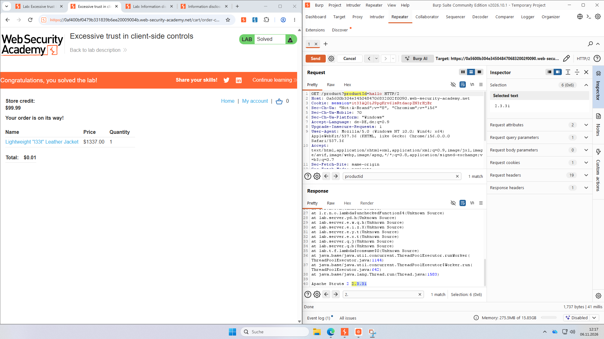
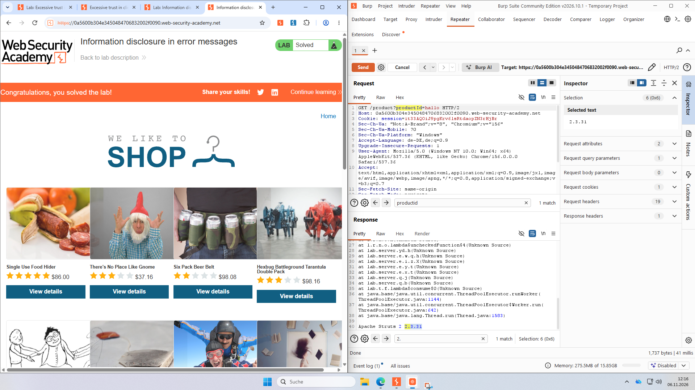

# Burp Suite Intro

---
**Name:** David Weinberger, Lukas Haselberger  
**Klasse:** 5AHITS  
**Datum:** 11.10.2026  
**Fach:** ITSE - Labor  
**Link:** https://www.franzmatejka.at/htl/doc/ITSI_5/itsi5-lecture/04_burp.html

## Übung 1.1 (PortSwigger Account)

Erledigt
 

## Übung 1.2 (Burp Suite Intro)

### Step 1:
Erledigt

### Step 2:
Erledigt

### Step 3:

Erledigt

### Step 4:
Erledigt

### Step 5:

## Übung 1.3 (TryHackMe Account)

## Übung 1.4 (TryHackMe – Neighbour)

## Übung 1.5 (TryHackMe – Burpsuite Repeater)

## Nicht gemacht
